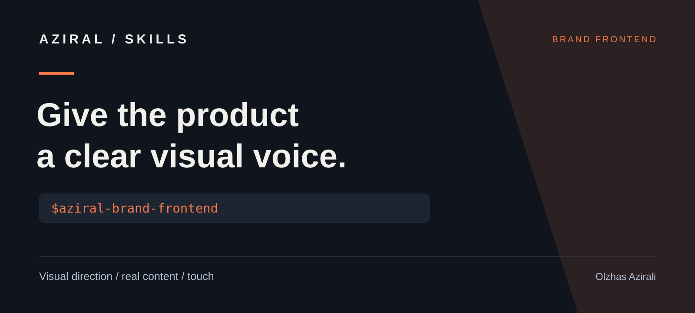

# AZIRAL Brand Frontend

**An independent AZIRAL skill by Olzhas Azirali.** This repository is not affiliated with or endorsed by Leonxlnx. The original [Taste Skill by Leonxlnx](https://github.com/Leonxlnx/taste-skill) is a separate project. All workflow instructions in this repository were written for AZIRAL; no upstream code, skill text, or visual assets are included.



[Русская версия](README.ru.md) | [Skill](skills/aziral-brand-frontend/SKILL.md) | [Example brief](examples/multilingual-product-brief.md) | [MIT license](LICENSE)

A useful frontend starts with the product's own facts and the actions people need to take. This skill turns that material into a clear visual direction, then checks how it works across languages, touch input, keyboard input, and reduced motion.

## Install

In an agent environment that supports Agent Skills:

```bash
npx skills add azirali/taste-skill --skill aziral-brand-frontend
```

For manual installation, copy `skills/aziral-brand-frontend` into your agent's skills directory. Load it as `$aziral-brand-frontend` in Codex. The folder contains instructions and reference templates; it does not install a frontend framework or a browser extension.

## Try it

```text
Use $aziral-brand-frontend to improve our product page in Russian,
English, and Kazakh. Keep our existing brand and routes. Make the
interactive hero work with touch, keep normal page scrolling, and
verify the result in the browser. Use the assets already in the project.
```

## What the workflow produces

- A short brief that separates verified brand facts, content, available assets, and user actions.
- A visual direction expressed as typography, spacing, color, image treatment, and motion decisions.
- An interface that uses real localized content and gives touch and keyboard users equivalent actions.
- A browser review with named viewports, tested actions, screenshots, and unresolved issues.

For small component changes, keep the surrounding visual system and use the relevant checks. A whole new direction is useful when the request calls for a redesign.

## Included files

| File | Purpose |
| --- | --- |
| [SKILL.md](skills/aziral-brand-frontend/SKILL.md) | The workflow and routing boundaries |
| [agents/openai.yaml](skills/aziral-brand-frontend/agents/openai.yaml) | Codex display metadata and example prompt |
| [Brief template](skills/aziral-brand-frontend/references/brief-template.md) | Product truth, language constraints, and interaction decisions |
| [Verification template](skills/aziral-brand-frontend/references/verification-template.md) | Repeatable browser review record |
| [Example brief](examples/multilingual-product-brief.md) | A hypothetical trilingual app page with a touch-sensitive hero |

## Working alongside Taste Skill

If your environment also provides Leonxlnx's Taste Skill, it can supply an art-direction workflow. This AZIRAL skill adds a product-fact brief, multilingual constraints, input equivalence, and delivery evidence. Choose the instructions relevant to the task and keep the user's explicit visual choices.

The example in this repository is a hypothetical brief, not a claim about a completed client project. Review evidence is created when the skill is used on an actual interface.

## Contribute

A useful issue includes a small brief or reproducible interaction, the expected result, the actual result, and a screenshot if it explains the problem. Keep private client data out of examples. Improvements to language checks and mobile interaction cases are welcome.

Created by [Olzhas Azirali](https://github.com/azirali), founder of [AZIRAL](https://aziral.com). Original files in this repository are available under the [MIT license](LICENSE). Other tools keep their own licenses.

## More AZIRAL skills

[HyperFrames workflows](https://github.com/azirali/hyperframes) · [Remotion promos](https://github.com/azirali/remotion) · [Brand frontend](https://github.com/azirali/taste-skill) · [UI release review](https://github.com/azirali/impeccable)

If this workflow helps your work, a star helps other developers discover it.
